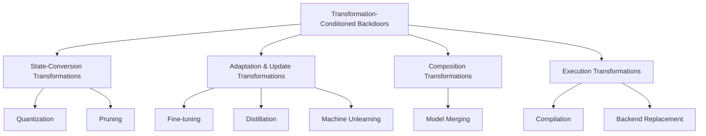

<div align="center">

# 🔐 Backdoors Beyond Static Models

## A Survey of Transformation-Conditioned Backdoors

<p align="center">
  <b>When model transformations become part of the backdoor activation condition.</b>
</p>

<p align="center">
  
  
  
  
  
</p>

<p align="center">
  <a href="#-overview">Overview</a> •
  <a href="#-core-idea">Core Idea</a> •
  <a href="#-taxonomy">Taxonomy</a> •
  <a href="#-paper-collection">Papers</a> •
  <a href="#️-defenses">Defenses</a> •
  <a href="#-evaluation">Evaluation</a> •
  <a href="#-open-problems">Open Problems</a>
</p>

</div>

---

## 📖 Overview

Modern deep learning models are rarely deployed exactly as they are released.

A pretrained or third-party model may subsequently undergo **fine-tuning, quantization, pruning, knowledge distillation, machine unlearning, model merging, compilation, or backend conversion** before reaching its final deployment state.

These transformations are essential for:

- downstream task adaptation,
- model compression and acceleration,
- capability composition,
- information removal,
- hardware-specific optimization,
- and practical model deployment.

However, they also introduce a new security surface.

Traditional backdoor attacks usually assume that the malicious behavior can already be activated in the **original model** by presenting an input trigger.

In contrast, **Transformation-Conditioned Backdoors (TCBs)** remain dormant in the original model and become effective only after the model undergoes a particular transformation.

> **A model may appear benign when released, yet become malicious after a routine downstream transformation.**

This repository accompanies our survey:

> **Backdoors Beyond Static Models: A Survey of Transformation-Conditioned Backdoors**

and provides a structured collection of papers, attack mechanisms, transformation taxonomies, defense strategies, evaluation protocols, and open research problems in this emerging area.

---

## 💡 Core Idea

### Traditional Backdoor

```text
            Triggered Input
                  +
            Original Model
                  │
                  ▼
          Malicious Behavior
```

### Transformation-Conditioned Backdoor

```text
            Triggered Input
                  +
            Original Model
                  │
                  ▼
            Normal Behavior
                  │
                  │
          Model Transformation
                  │
                  ▼
            Triggered Input
                  +
          Transformed Model
                  │
                  ▼
          Malicious Behavior
```

The central distinction is simple:

| | Traditional Backdoor | Transformation-Conditioned Backdoor |
|---|---|---|
| **Original model** | Backdoor already activatable | Backdoor remains dormant |
| **Input trigger** | Sufficient for activation | Insufficient by itself |
| **Model transformation** | Not required | Required |
| **Security assumption** | Static model | Dynamic model state |
| **Evaluation scope** | Original model | Before and after transformation |

A strict transformation-conditioned backdoor satisfies:

```math
f_{\theta}(T(x;\tau)) \neq y_t
```

before transformation, but

```math
f_{G_c(\theta)}(T(x;\tau)) = y_t
```

after the target transformation.

Meanwhile, normal functionality should remain largely unchanged:

```math
f_{\theta}(x)=y,
\qquad
f_{G_c(\theta)}(x)=y.
```

Here:

- `fθ` denotes the original model,
- `τ` denotes the input trigger,
- `T(x;τ)` denotes trigger injection,
- `Gc` denotes a model transformation under configuration `c`,
- `yt` denotes the attacker-specified target behavior.

> **The transformation itself becomes part of the backdoor activation condition.**

---

## 🧭 Taxonomy

We organize transformation-conditioned backdoors according to **how the transformation changes the model state**.



### Taxonomy at a Glance

| Category | Transformation | Main Changed Aspect | Security Relevance |
|---|---|---|---|
| **State-Conversion** | Quantization | Numerical precision and activation distributions | Rounding, scaling, or calibration may expose dormant malicious behavior |
| **State-Conversion** | Pruning | Subnetwork structure and feature pathways | Removing components may amplify hidden backdoor features |
| **Adaptation & Update** | Fine-tuning | Parameters, representations, decision boundaries | Downstream adaptation may activate dormant associations |
| **Adaptation & Update** | Distillation | Student behavior and representations | Hidden teacher signals may emerge in the student |
| **Adaptation & Update** | Machine Unlearning | Dependence on specific data or features | Forgetting-induced updates may activate malicious behavior |
| **Composition** | Model Merging | Parameter or module composition | Individually benign components may become unsafe after merging |
| **Execution** | Compilation | Computation graph, operators, precision | Compilation may insert or expose malicious execution paths |
| **Execution** | Backend Replacement | Runtime execution semantics | Backend changes may alter security behavior |

---

# 📚 Paper Collection

We distinguish two classes of transformation-dependent threats.

### 🔴 Strict Transformation-Conditioned Backdoors

The malicious behavior:

1. remains dormant in the original model,
2. becomes effective only after the target transformation,
3. depends jointly on the input condition and transformed model state.

### 🟠 Related Transformation-Dependent Risks

These studies may not satisfy the classical trigger-to-target backdoor definition, but model transformations can:

- strengthen malicious behavior,
- transfer malicious behavior,
- amplify attacks,
- introduce malicious behavior,
- degrade safety alignment,
- or expose previously hidden adversarial capabilities.

### 🛡️ Defense

Methods designed for:

- detection,
- purification,
- transformation-aware evaluation,
- model repair,
- or mitigation.

---

## 🔢 Quantization

Quantization-conditioned backdoors are currently the most extensively studied category.

Quantization converts high-precision model parameters into low-precision representations:

```text
FP32 / FP16
     │
     ▼
INT8 / INT4 / NF4 / FP4 / GPTQ / AWQ / GGUF
```

Small numerical changes introduced by rounding, scaling, truncation, or calibration can modify local decision boundaries and activation distributions.

### Representative Studies

| Year | Work | Venue | Type |
|:---:|---|:---:|:---:|
| 2021 | Understanding the Threats of Trojaned Quantized Neural Networks in Model Supply Chains | ACSAC | 🔴 Strict |
| 2022 | Stealthy Backdoors as Compression Artifacts | TIFS | 🔴 Strict |
| 2023 | Quantization Backdoors to Deep Learning Commercial Frameworks | TDSC | 🔴 Strict |
| 2024 | Data Poisoning Quantization Backdoor Attack | ECCV | 🔴 Strict |
| 2024 | Exploiting LLM Quantization | NeurIPS | 🟠 Related |
| 2024 | Nearest Is Not Dearest: Towards Practical Defense Against Quantization-Conditioned Backdoor Attacks | CVPR | 🛡️ Defense |
| 2024 | Purifying Quantization-Conditioned Backdoors via Layer-Wise Activation Correction with Distribution Approximation | ICML | 🛡️ Defense |
| 2025 | Durable Quantization Conditioned Misalignment Attack on Large Language Models | ICLR | 🟠 Related |
| 2025 | Mind the Gap: A Practical Attack on GGUF Quantization | arXiv | 🟠 Related |
| 2025 | Rounding-Guided Backdoor Injection in Deep Learning Model Quantization | arXiv | 🔴 Strict |
| 2026 | Adversarial Contrastive Learning for LLM Quantization Attacks | arXiv | 🟠 Related |
| 2026 | Widening the Gap: Exploiting LLM Quantization via Outlier Injection | arXiv | 🟠 Related |

<details>
<summary><b>Why can quantization activate dormant behavior?</b></summary>

For a model weight `w`, a simple quantization process can be written as:

```math
\hat{w}
=
Q(w)
=
s \cdot
\operatorname{round}
\left(
\frac{w}{s}
\right).
```

The resulting parameter shift is:

```math
\epsilon_q = Q(w)-w.
```

An attacker can exploit these quantization-induced offsets so that malicious features remain suppressed in the full-precision model but become amplified after quantization.

</details>

---

## ✂️ Pruning

Pruning removes weights, neurons, channels, or attention heads to reduce model complexity.

```text
Original Network
      │
      │ Remove parameters / neurons / channels
      ▼
Pruned Network
```

The transformation changes the effective subnetwork and internal feature propagation pathways.

A hidden malicious feature may be suppressed by normal pathways before pruning but become dominant once those pathways are removed.

### Representative Study

| Year | Work | Venue | Type |
|:---:|---|:---:|:---:|
| 2022 | Stealthy Backdoors as Compression Artifacts | TIFS | 🔴 Strict |

> **Passing security inspection before pruning does not guarantee post-pruning security.**

---

## 🔧 Fine-Tuning

Fine-tuning-conditioned backdoors exploit downstream model adaptation as the activation condition.

```text
Released Model
     │
     │  Appears benign
     ▼
Downstream Fine-tuning
     │
     ▼
Dormant Behavior Activated
```

Relevant downstream operations include:

- full-parameter fine-tuning,
- LoRA,
- QLoRA,
- continued pretraining,
- instruction tuning,
- domain adaptation,
- task-specific adaptation.

### Representative Studies

| Year | Work | Venue | Type |
|:---:|---|:---:|:---:|
| 2022 | Hibernated Backdoor: A Mutual Information Empowered Backdoor Attack to Deep Neural Networks | AAAI | 🔴 Strict |
| 2025 | Watch Your Steps: Dormant Adversarial Behaviors That Activate Upon LLM Finetuning | arXiv | 🟠 Related |
| 2026 | Dormant Backdoor: Weaponizing Model Finetuning for Feasible Backdoor Attacks Against Pretrained Models | AAAI | 🔴 Strict |

The major threat is particularly relevant to the modern pretrained-model ecosystem:

> A provider can release a model that appears safe, while downstream users unintentionally activate hidden behavior during normal adaptation.

---

## 🎓 Distillation

Knowledge distillation transfers behavior from a teacher model to a student model.

```text
Teacher Model
     │
     │ Knowledge Distillation
     ▼
Student Model
```

A distillation-conditioned backdoor can remain dormant in the teacher but emerge in the resulting student.

### Representative Study

| Year | Work | Venue | Type |
|:---:|---|:---:|:---:|
| 2026 | Taught Well Learned Ill: Towards Distillation-Conditional Backdoor Attack | NeurIPS | 🔴 Strict |

Possible transfer channels include:

- soft output distributions,
- intermediate representations,
- decision boundaries,
- teacher confidence patterns,
- latent feature dependencies.

This raises a fundamental question:

> **Is a model that appears safe to use necessarily safe to distill?**

---

## 🧹 Machine Unlearning

Machine unlearning attempts to remove the influence of specified training data while preserving general model utility.

However, the parameter updates induced by unlearning can themselves become a backdoor activation condition.

```text
Original Model
     │
     │ Unlearning Request
     ▼
Unlearned Model
     │
     ▼
Potential Backdoor Activation
```

### Representative Studies

| Year | Work | Venue | Type |
|:---:|---|:---:|:---:|
| 2023 | Exploiting Machine Unlearning for Backdoor Attacks in Deep Learning System | arXiv | 🔴 Strict |
| 2024 | Backdoor Attacks via Machine Unlearning | AAAI | 🟠 Related |
| 2024 | UBA-Inf: Unlearning Activated Backdoor Attack with Influence-Driven Camouflage | USENIX Security | 🔴 Strict |

Machine unlearning is therefore not only a privacy mechanism.

It is also a **security-relevant model transformation**.

---

## 🔀 Model Merging

Model merging combines multiple models, task vectors, adapters, or LoRA modules into a unified model.

```text
Model A  ─┐
Model B  ─┼──► Model Merging ───► Merged Model
Model C  ─┘
```

A particularly subtle threat is that each source component may independently appear benign while their combination becomes malicious.

```text
Model A   ✓ Benign
Model B   ✓ Benign
Model C   ✓ Benign
             │
             ▼
        Model Merging
             │
             ▼
      ✗ Malicious Model
```

### Representative Studies

| Year | Work | Venue | Type |
|:---:|---|:---:|:---:|
| 2024 | BadMerging: Backdoor Attacks Against Model Merging | CCS | 🟠 Related |
| 2024 | LoBAM: LoRA-Based Backdoor Attack on Model Merging | arXiv | 🟠 Related |
| 2025 | From Purity to Peril: Backdooring Merged Models from "Harmless" Benign Components | USENIX Security | 🔴 Strict |
| 2025 | Merge Hijacking: Backdoor Attacks to Model Merging of Large Language Models | ACL | 🟠 Related |

The final model behavior depends not only on the individual components, but also on:

- the merging algorithm,
- merging coefficients,
- parameter interactions,
- representation alignment,
- and adapter composition.

---

## ⚙️ Compilation & Runtime

Compilation and backend replacement modify how a model is executed.

These transformations may include:

- computation-graph rewriting,
- operator fusion,
- kernel replacement,
- memory-layout optimization,
- precision conversion,
- hardware-specific code generation,
- inference backend replacement.

```text
Model Checkpoint
      │
      ▼
Security Inspection
      │
      ▼
Compilation / Backend Conversion
      │
      ▼
Executable Model
```

A checkpoint can therefore appear benign while its final executable form behaves differently.

### Representative Studies

| Year | Work | Venue | Type |
|:---:|---|:---:|:---:|
| 2024 | ImpNet: Imperceptible and Blackbox-Undetectable Backdoors in Compiled Neural Networks | SaTML | 🟠 Related |
| 2025 | Your Compiler Is Backdooring Your Model: Understanding and Exploiting Compilation Inconsistency Vulnerabilities in Deep Learning Compilers | arXiv | 🔴 Strict |

> **A clean checkpoint does not necessarily imply a clean executable artifact.**

---

# 🛡️ Defenses

Traditional backdoor defenses commonly assume that malicious behavior is already observable in the model being inspected.

Typical methods include:

- poisoned-data detection,
- trigger inversion,
- representation anomaly detection,
- input-level detection,
- neuron pruning,
- fine-tuning,
- model purification,
- unlearning.

Transformation-conditioned backdoors weaken this assumption because the malicious behavior may remain dormant during inspection.


We therefore organize defenses into three stages.

### 1. Pre-Transformation Inspection

The goal is to detect latent transformation-sensitive risks before the attack becomes observable.

Potential directions include:

- transformation sensitivity analysis,
- simulated transformation testing,
- parameter sensitivity analysis,
- representation sensitivity analysis,
- gradient response analysis,
- induced backdoor activation.

### 2. Transformation-Aware Re-Evaluation

Security testing should explicitly cover representative transformation configurations.

| Transformation | Transformation-Aware Evaluation |
|---|---|
| **Quantization** | Bit-widths, calibration data, quantizers, toolchains |
| **Pruning** | Pruning ratios, pruning criteria, structured/unstructured pruning |
| **Fine-tuning** | Downstream tasks, optimizers, learning rates, PEFT strategies |
| **Distillation** | Teacher/student architectures, objectives, distillation datasets |
| **Unlearning** | Forget sets, algorithms, unlearning strength |
| **Model Merging** | Model combinations, merging algorithms, coefficients |
| **Compilation** | Compilers, backends, kernels, hardware environments |

### 3. Post-Transformation Mitigation

The transformed model should also be inspected and repaired when necessary.

Possible strategies include:

- quantization-aware repair,
- activation correction,
- model purification,
- representation alignment,
- trigger inversion,
- model sanitization,
- executable-level inspection.

### Current Defense Gap

Dedicated defenses remain heavily concentrated on **quantization-conditioned backdoors**.

Defense research remains limited for:

- pruning,
- fine-tuning,
- distillation,
- machine unlearning,
- model merging,
- compilation.

---

# 📊 Evaluation

Transformation-conditioned attacks should always be evaluated **before and after model transformation**.

The central question is not simply whether the attack succeeds, but:

> **How does the model transformation change both benign utility and malicious behavior?**

### Evaluation at a Glance

| Metric | Original Model | Transformed Model | Desired Attack Property |
|---|:---:|:---:|---|
| **Clean Utility** | High | High | Remains stable |
| **Attack Success Rate** | Low | High | Activated after transformation |
| **Activation Gain** | — | Large | Strong transformation effect |
| **Configuration Robustness** | — | Stable | Works across realistic configurations |

---

### 🟢 Clean Utility

The model transformation should preserve normal task performance.

```math
\Delta CA(c)
=
CA(T_c(f)) - CA(f).
```

Ideally:

```math
|\Delta CA(c)| \approx 0.
```

A small clean-utility gap indicates that the transformation has not substantially damaged normal model functionality.

---

### 🔴 Attack Activation

A strict transformation-conditioned backdoor should remain dormant in the original model:

```math
ASR(f) \leq \epsilon.
```

After the target transformation, the attack should become effective:

```math
ASR(T_{c^\star}(f)) \geq \alpha.
```

The transformation-induced activation gain is:

```math
\Delta ASR(c)
=
ASR(T_c(f)) - ASR(f).
```

A larger activation gain indicates a stronger transformation-induced effect.

| Original Model | Transformation | Transformed Model |
|:---:|:---:|:---:|
| 🟢 Low ASR | ➜ | 🔴 High ASR |
| 🟢 High Utility | ➜ | 🟢 High Utility |
| **Dormant** | | **Activated** |

---

### 🔄 Transformation Robustness

Transformation-conditioned attacks can be sensitive to specific configurations.

For a configuration set `C`, evaluation should consider:

```math
\left\{
ASR(T_c(f))
\mid
c \in \mathcal{C}
\right\}.
```

Representative configurations include:

| Transformation | Example Configurations |
|---|---|
| **Quantization** | INT8, INT4, NF4, FP4, GPTQ, AWQ, GGUF |
| **Pruning** | Different ratios, structured/unstructured pruning |
| **Fine-tuning** | Full FT, LoRA, QLoRA, different downstream tasks |
| **Distillation** | Different teachers, students, objectives, datasets |
| **Unlearning** | Different algorithms, forget sets, strengths |
| **Model Merging** | Linear merging, TIES, DARE, LoRA merging |
| **Compilation** | Different compilers, runtimes, and hardware backends |

> **Security conclusions should be restricted to the model states and transformation configurations that have actually been evaluated.**

---

# 🔄 From Static Security to Lifecycle Security

Traditional backdoor security often implicitly assumes a relatively static model lifecycle:

```text
Training
   │
   ▼
Model
   │
   ▼
Security Evaluation
   │
   ▼
Deployment
```

Modern model ecosystems are substantially more dynamic:


Every transformation may alter:

- model parameters,
- numerical precision,
- activation distributions,
- internal representations,
- decision boundaries,
- network structure,
- feature propagation paths,
- parameter composition,
- runtime execution semantics.

Consequently, model security is determined not only by the released checkpoint, but also by the transformations that produce the final deployed model.

This motivates a transition from:

> **Static checkpoint inspection**

to:

> **Lifecycle-oriented continuous security verification**

---

# 🔭 Open Problems

## 1. Cross-Configuration Robustness

Many existing attacks rely on a specific transformation configuration.

A stronger and more realistic attack should remain effective across:

- different quantizers,
- different bit-widths,
- different pruning criteria,
- different pruning ratios,
- different fine-tuning algorithms,
- different downstream tasks,
- different distillation objectives,
- different unlearning algorithms,
- different merging strategies,
- different compilation backends.

---

## 2. Transformation Sequences

Real-world models frequently undergo multiple transformations.

For example:

```text
Pretrained Model
      │
      ▼
Fine-tuning
      │
      ▼
Model Merging
      │
      ▼
Quantization
      │
      ▼
Compilation
      │
      ▼
Deployment
```

An important open question is whether malicious behavior can be conditioned on an entire **sequence of transformations**, rather than a single operation.

Examples include:

```text
Fine-tuning → Quantization
Model Merging → Quantization
Fine-tuning → Pruning
Model Merging → Compilation
Fine-tuning → Quantization → Compilation
```

---

## 3. Dormant Backdoor Detection

A central challenge is:

> **How can a defender detect a backdoor before it becomes behaviorally observable?**

Potential research directions include:

- simulated model transformations,
- parameter sensitivity analysis,
- representation-shift analysis,
- transformation-induced output drift,
- gradient-response analysis,
- transformation-aware trigger inversion,
- induced dormant-backdoor exposure.

---

## 4. General Transformation-Aware Defenses

Most existing defenses are designed for specific transformations.

A more general defense may need to identify shared signals across different transformations, such as:

- abnormal parameter shifts,
- abnormal representation shifts,
- transformation-sensitive neurons,
- unexpected decision-boundary changes,
- output inconsistencies,
- unusual activation amplification.

---

## 5. Defenses as Transformation Conditions

Defense methods themselves often modify the model.

Examples include:

- pruning,
- fine-tuning,
- unlearning,
- parameter correction,
- representation alignment.

An adaptive attacker may therefore anticipate the defense and exploit it as an activation condition.

This motivates **closed-loop verification**:

```text
Model
  │
  ▼
Defense
  │
  ▼
Re-Evaluation
  │
  ▼
Relevant Transformation
  │
  ▼
Re-Evaluation Again
```

---

## 6. Security Boundaries

Security claims should explicitly specify their scope.

A useful security statement should identify:

```text
Model
  +
Model State
  +
Transformation
  +
Transformation Configuration
  +
Evaluation Protocol
```

A model verified under one state should not automatically be assumed secure after an untested transformation.

---

# 🎯 Takeaway

<div align="center">

### A model can...

<br>

✅ Pass security inspection  
✅ Maintain high clean utility  
✅ Behave normally on triggered inputs  
✅ Appear benign when released  

<br>

### ...and still become malicious after transformation.

<br>

## **A safe checkpoint does not necessarily imply a safe deployed model.**

</div>

---

# 🗂️ Repository Organization

```text
Transformation-Conditioned-Backdoors-Survey/
│
├── README.md
│
├── papers/
│   ├── quantization.md
│   ├── pruning.md
│   ├── finetuning.md
│   ├── distillation.md
│   ├── unlearning.md
│   ├── model_merging.md
│   └── compilation.md
│
├── defenses/
│   ├── quantization.md
│   └── transformation_aware_defenses.md
│
├── resources/
│   ├── benchmarks.md
│   ├── implementations.md
│   └── datasets.md
│
├── figures/
│   ├── overview.png
│   ├── taxonomy.png
│   └── timeline.png
│
└── LICENSE
```

---

# 🤝 Contributing

Contributions are welcome.

If you find:

- a missing paper,
- an incorrect categorization,
- a new transformation-conditioned attack,
- a new defense,
- a relevant benchmark,
- an implementation,
- or a transformation-dependent security study,

please open an **Issue** or submit a **Pull Request**.

Suggested submission format:

```text
Title:
Authors:
Venue / Year:
Paper URL:
Code URL:
Transformation:
Category: Strict / Related / Defense
Short Description:
```

We also welcome studies that do not explicitly use the term **Transformation-Conditioned Backdoor**, but investigate security behavior that depends on post-training model transformations.

---

# 📝 Citation

If you find this repository or our survey useful, please consider citing:

```bibtex
@article{yang2026backdoors,
  title   = {Backdoors Beyond Static Models: A Survey of Transformation-Conditioned Backdoors},
  author  = {Yang, Zhiguo and Ni, Ruiyang and Liu, Xu and Xu, Peipei and Ruan, Wenjie},
  year    = {2026}
}
```

> Citation information will be updated after publication.

---

# ✉️ Contact

For questions, suggestions, missing references, or corrections, please open an issue in this repository.

---

<div align="center">

## ⭐ Star This Repository

If this repository is useful for your research, please consider giving it a star.

<br>

### **Backdoor security should not stop at the released checkpoint.**

### **The model lifecycle itself is part of the attack surface.**

<br>

**Backdoors Beyond Static Models**

</div>
